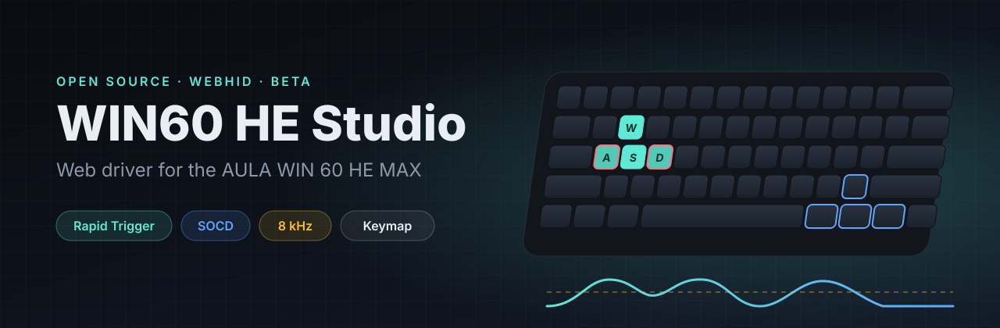

<p align="center">
  
</p>

<h1 align="center">WIN60 HE Studio</h1>

<p align="center">
  <b>Open source web driver and configurator for the AULA WIN 60 HE MAX magnetic (Hall effect) keyboard.</b><br />
  Rapid Trigger, SOCD (snap tap), key remapping and 8000 Hz polling, straight from your browser via WebHID.<br />
  No installer, no executable, nothing to download.
</p>

<p align="center">
  <a href="https://primebuild-pc.github.io/aula-win60he-tool/"></a>
  
  <a href="LICENSE"></a>
  
</p>

---

## Why

The official AULA web driver is still rough, and some features ask you to download a desktop app that Chrome flags
as dangerous. WIN60 HE Studio talks to the keyboard with the same protocol as the official driver (SparkLink KB2),
but **every write is read back and verified** and commands are sent **one at a time**, so settings never get mixed up.

It was built to fix a real problem: a broken Fn layer and A/D keys that stopped typing after using the official
software. If your AULA WIN 60 HE MAX has keys that send arrows instead of letters, this tool fixes it in one click.

## Features

### New in 0.2.0

- **RGB lighting:** static color, 20 firmware effect IDs, brightness, speed, direction, seven-color palette, per-key painting and lights off. A local color preview works before connecting. Effect names and animations depend on the firmware; the preview does not simulate them.
- **Easier mapping:** searchable function tiles, category filters, physical key capture, a before/after preview and protection for the Fn key.
- **Light, dark and system themes**, plus Italian/English interface preferences saved in your browser. Diagnostic logs retain their original text.
- **SOCD on A/D and W/S**, independently, with actual configuration included in backups.
- **Four onboard profiles**, shown only when reported by the keyboard, and a guided sensor calibration flow.
- **Advanced keys (beta):** Mod-Tap, Toggle, DKS and Rappy Snappy, with readback and removal controls.
- **Backup v4:** fresh readings of every key, layers, performance, SOCD, RGB and supported advanced payloads. Legacy v3 files remain importable; unknown advanced modes are rejected rather than silently dropped.
- Faster initial diagnosis, disconnect handling, pausing sensor polling in hidden tabs, responsive navigation and accessible keyboard controls.

The new hardware controls have automated packet and simulated-transport tests. **Physical validation of RGB, advanced behaviors, profile switching and calibration is still pending.** Firmware flashing and onboard macro editing are not included; see [the handoff](docs/RELEASE-0.2.0.md) for the concrete blockers.

<table>
  <tr>
    <td width="50%" valign="top">
      <h3>⇅ Rapid Trigger and actuation</h3>
      Rapid Trigger on any key, actuation point from 0.1 to 3.4 mm, separate press and release sensitivity,
      top and bottom dead zones, with a live preview of the key travel.
    </td>
    <td width="50%" valign="top">
      <h3>⇄ SOCD / snap tap</h3>
      Simultaneous Opposing Cardinal Directions on A/D: last input wins, A priority, D priority, or neutral.
      Written in the exact format used by the official driver.
    </td>
  </tr>
  <tr>
    <td valign="top">
      <h3>⌨ Key remapping</h3>
      Remap every key on the base layer and on the Fn layer: letters, F-keys, navigation, modifiers and media keys.
    </td>
    <td valign="top">
      <h3>◉ Key tester and travel visualizer</h3>
      A 3D keycap that follows the real travel read from the magnetic sensors (beta), a travel graph over time,
      and a tester that shows exactly what reaches the operating system.
    </td>
  </tr>
  <tr>
    <td valign="top">
      <h3>◎ One-click FPS profile</h3>
      Rapid Trigger on every key, SOCD on A/D, arrow keys on the Fn layer and 8 kHz polling, tuned for competitive
      shooters like Counter-Strike 2, Valorant and Apex Legends.
    </td>
    <td valign="top">
      <h3>⇩ Backup and restore</h3>
      Save layers, per-key performance, SOCD pairs, RGB and supported advanced key settings to a JSON file.
    </td>
  </tr>
</table>

## Quick start

1. Open **[the web driver](https://primebuild-pc.github.io/aula-win60he-tool/)** in **Chrome** or **Edge** on desktop.
2. Plug the keyboard in with the cable, ideally into a USB port directly on the PC (no hub; this matters for 8 kHz).
3. Close any other tab running the AULA driver, click **Connetti tastiera** (Connect keyboard) and pick `WIN 60 HE MAX`.
4. From **Panoramica** (Overview) apply the FPS profile, or tune everything by hand in the other sections.

Settings are stored in the keyboard's own memory: they stay when you unplug it or move it to another computer.

> [!NOTE]
> Choose Italian or English and light, dark or system theme in the top bar. Explore mapping and RGB previews before connecting.

### Default FPS profile

| Setting | Value |
|---|---|
| Actuation point | 0.5 mm on every key |
| Rapid Trigger | 0.15 mm press and release |
| Dead zones | 0.15 mm top and bottom |
| SOCD | A/D, last input wins |
| Polling rate | 8000 Hz |
| Arrow keys | Fn + W/A/S/D and Fn + <kbd>/</kbd> <kbd>Right Alt</kbd> <kbd>Menu</kbd> <kbd>Right Ctrl</kbd> |

> [!IMPORTANT]
> **Firmware limitation:** the firmware ignores the Fn layer on keys that have SOCD enabled, so Fn+A and Fn+D cannot
> send arrows while SOCD is on. Use Fn + Right Alt and Fn + Right Ctrl for left and right (Wooting-style layout).

## Compatibility

| | |
|---|---|
| Keyboard | AULA WIN 60 HE MAX (USB `1CA2:1902`, vendor interface `FFA0:0001`) |
| Verified protocol | 1.0.9 |
| Browsers | Chrome and Edge on desktop (WebHID). Firefox and Safari do not support WebHID. |
| Operating systems | Windows, macOS, Linux (Linux may need a udev rule for HID access) |

Other AULA keyboards built on the same SparkLink chip may work, but they have not been tested. Reports are welcome
in the [issues](https://github.com/PrimeBuild-pc/aula-win60he-tool/issues).

## FAQ

<details>
<summary><b>The A and D keys (or WASD) type nothing or send arrows. How do I fix it?</b></summary>

The keyboard's base layer has arrow codes written on those keys, usually after a bad write from another tool.
Connect, then click **Imposta frecce Fn** (Set Fn arrows) in the Overview: it restores W/A/S/D as letters on the base
layer and puts the arrows on the Fn layer.
</details>

<details>
<summary><b>Is it safe? Does it flash firmware?</b></summary>

No firmware is flashed or modified. The tool only writes settings, using the same commands as the official driver,
and verifies each one. Download a backup before making large changes.
</details>

<details>
<summary><b>Is 8000 Hz polling really active?</b></summary>

The Overview reads the current polling rate straight from the keyboard. 8 kHz needs a direct USB port; through a
hub or a front-panel port it may fall back to a lower rate.
</details>

<details>
<summary><b>Why a web driver and not a desktop app?</b></summary>

WebHID runs inside the browser sandbox: nothing to install, no admin rights, no unsigned executable, and the code is
fully open for anyone to review.
</details>

## Local development

```bash
npm install
npm run dev
```

Then open `http://127.0.0.1:5199` in Chrome. On Windows you can also double-click `start.cmd`.

```text
src/aula.js       keyboard protocol layer (connect, read, write, verify)
src/keycodes.js   HID key codes, labels and physical layout
src/main.js       user interface
src/workspace.js  RGB, mapping tools, profiles and calibration
src/settings.js   settings and backup validation, trigger display model
src/i18n.js       Italian / English interface
src/style.css     styles (dark and light theme)
```

<details>
<summary><b>Protocol notes</b></summary>

- SDK: `@sparklinkplayjoy/sdk-keyboard` (KB2 protocol, same as the AULA web driver). A `SYNCPack` must be sent after `init()`.
- Layers: `layout 0` is the base layer, `layout 1` is the Fn layer, `2-3` are unused. `getLayoutKeyInfo` returns `{key, layout, value}`; about 15 keys fit in one 64-byte packet.
- Key codes are standard HID usages. Media keys are `0x1000 | consumer usage` (e.g. `0x10EA` volume down), `0xF001` is Fn, `0xF3xx` are vendor functions.
- Performance: `Layout_Mode` = `(touchMode << 4) | advancedKeyMode`; `advancedKeyMode 8` is SOCD. Travel values are in microns (`mm * 1000`).
- SOCD (protocol 1.0.7 and later): `[pos1, pos2, key1(2), key2(2), type, mode, delay(2)]`, `type 0` binds by position.
- Polling: `setRateOfReturn(0..6)` maps to 8K, 4K, 2K, 1K, 500, 250 and 125 Hz.
- Live travel: `getRm6X21Travel()` returns a 6×21 matrix in millimetres.

</details>

### Verification

```bash
npm test                     # unit and real SDK packet tests with simulated USB transport
npm run build
npx playwright install chromium
npm run test:e2e             # navigation, mapping, RGB drafts, themes, language, axe, responsive layouts
```

GitHub Pages CI runs the same tests before deploying. Browser tests use the production preview when no development server is already running.

## Disclaimer

This project is not affiliated with or endorsed by AULA or SparkLink. AULA and WIN 60 HE MAX are trademarks of their
respective owners. Use at your own risk.

## License

[MIT](LICENSE)
